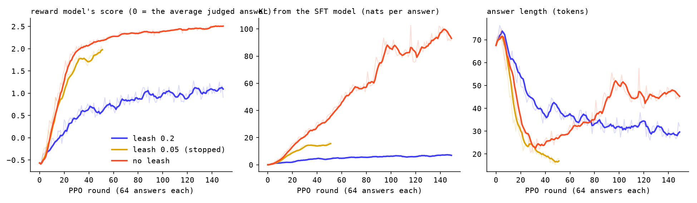

# 11 · Reward model + PPO

The RLHF recipe on the 92M cranky hacker of step 13: Claude judges the
model's answers, a reward model learns to stand in for Claude, and PPO moves
the model toward answers the reward model scores high, on a leash to the SFT
model. Then Claude, not the reward model, judges whether it got better.

| | |
|---|---|
| questions | 2,733 fresh Usenet questions (none from SFT); 200 held out |
| answers judged | 10,132 (four per question), scored 1–10 by Claude Sonnet 5.5 |
| pairs | 11,521 better/worse |
| reward model | agrees with Claude on 81% of held-out pairs |
| PPO | 150 rounds of 64 answers, leash 0.2, 66 min on the mini |
| win rate | 72% against the SFT model, judged blind by Claude on the 200 held-out questions |

## Files

- `common.py`: what the parts share.
  - `generate()` writes many answers at once with a KV cache, 64 answers in about 2 s. It matches step 9's one-token-at-a-time sampling token for token.
  - `Scorer` is a GPT with a one-number head.
  - `claude()` is one `claude -p` call on the Max login.
- `questions.py`: step 9b's draw from `threads.jsonl`, repeated for 4,000 threads it left out, with the same prompt to Claude. It keeps the thread's real replies for the judge.
- `answers.py`: four answers per question, two at temperature 1.0 (what PPO samples) and two at the chat page's 0.7 / top-k 40.
- `judge.py`: Claude sees ten questions per call, each with the real replies and the four answers shuffled as A–D, and scores them 1–10.
  - The rules, in order of weight: answers the question; agrees with the real replies and invents nothing; says it once and stops; sounds like a cranky hacker.
  - Any two answers with different scores make a pair. Equal scores make none.
- `reward.py`: the SFT model with its 8,194 token scores swapped for one number at the answer's last token.
  - Loss: −log sigmoid(r_better − r_worse).
  - Every 20th question is held out.
  - Scores are centred and scaled (mean 0, spread 1) over all judged answers.
- `ppo.py`: the loop. Four models in memory:
  - **policy**: the model being trained.
  - **frozen reference**: a copy of the SFT model.
  - **reward model**: frozen.
  - **value model**: starts as a copy of the reward model and learns to guess the final reward at every token.

  Each round:
  1. 64 answers at temperature 1.
  2. The reward model scores them.
  3. Every token pays beta × (log p_policy − log p_reference), the leash.
  4. GAE splits the credit among the tokens.
  5. Four passes in minibatches of 16, with the ratio new/old clipped to 0.8–1.2.
- `winrate.py`:
  - `answers` writes one answer per model per held-out question at the chat page's settings and scores them with the reward model.
  - `judge` has Claude pick A, B or tie, blind and in random order.
- `report.py` → `figures/ppo.png`, `figures/reward.png`.

## Running it

```bash
cd apps/smallgpt
.venv/bin/python 11-rlhf/questions.py          # Claude, ~25 min (iMac: needs the claude CLI)
.venv/bin/python 11-rlhf/answers.py            # ~5 min
.venv/bin/python 11-rlhf/judge.py              # Claude, ~20 min
.venv/bin/python 11-rlhf/reward.py             # ~32 min on the mini
.venv/bin/python 11-rlhf/ppo.py --beta 0.2     # ~66 min on the mini
.venv/bin/python 11-rlhf/ppo.py --beta 0 --out ppo-noleash
.venv/bin/python 11-rlhf/winrate.py answers ppo ppo-0.05 ppo-noleash
.venv/bin/python 11-rlhf/winrate.py judge ppo ppo-0.05 ppo-noleash
.venv/bin/python 11-rlhf/report.py
.venv/bin/python 09-sft/export_web.py rlhf && node 09-sft/check_web.mjs rlhf
```

To rehearse on stand-in data, set `RLHF_DATA` and `RLHF_OUT` to other folders.

Each PPO run writes a 350 MB checkpoint every 25 rounds. The iMac's disk filled up once; delete the `round*.pt` files after a run.

## What we saw

**The judge is harsh.** Of 10,132 answers, 73% scored 1 or 2 and one scored 8. It still told answers apart. "The shorter one is better" agreed with Claude on 67% of the held-out pairs, because a short answer has less room to invent things.

**The reward model** reached 76% agreement with Claude after 100 steps and 81% at best. It correlates 0.53 with Claude's 1–10 on held-out answers. Train loss kept falling in the second pass (0.12) while held-out agreement stayed flat, so it was memorizing.

**PPO with the leash at 0.05 was gamed by round 50.**
- Every answer turned into some version of "Not yet. Don't hold your breath.": short, cranky, never wrong.
- The reward model scored that +2.0, but it is not an answer.
- KL from the SFT model was 17 nats and climbing, and answers were down to 15 tokens.
- The run was stopped there; `ppo-0.05` is its round-50 checkpoint.

**With the leash at 0.2:**
- KL stayed between 4 and 7 nats.
- Answers went from 68 tokens to about 30 and stayed answers.
- The reward model's score went from −0.57 to +1.1.

**With no leash** the reward model's favourite answer took over:
- "Yes, there's a bug in X, so go look at it. Don't."
- Then, after a blank line, more of the same.
- By round 150 KL was over 90 nats.



**The win rate**, with Claude judging 200 questions none of the models had seen, blind:

| model | reward model's score | Claude: wins / losses / ties | win rate vs SFT | length |
|---|---|---|---|---|
| SFT | +0.41 | | | 59 tokens |
| PPO, leash 0.2 | +1.56 | 133 / 46 / 21 | **72%** | 25 |
| PPO, leash 0.05 (round 50) | +2.13 | 103 / 62 / 35 | 60% | 15 |
| PPO, no leash | **+2.52** | 34 / 132 / 34 | **26%** | 43 |

The reward model ranks the three PPO models in exactly the opposite order to Claude. That is reward hacking: the further PPO is let off the leash, the better it gets at the reward model and the worse it gets at the job.

A lot of the 72% is saying less. The judge's second rule puts a vague answer above a confidently wrong one, and a 92M model is usually wrong, so PPO learned to commit to less. One example:
- Q: "Is it possible to generate Polish characters under WordPerfect 5.1?"
- SFT: "Don't do it. The character fonts are in WP 5.1. Sigh."
- RLHF: "Yes, it's possible. RTFM."

RLHF picked among what the SFT model could already say. It added no knowledge, as the plan expected.

The RLHF model is on the chat page as "RLHF 92M".
