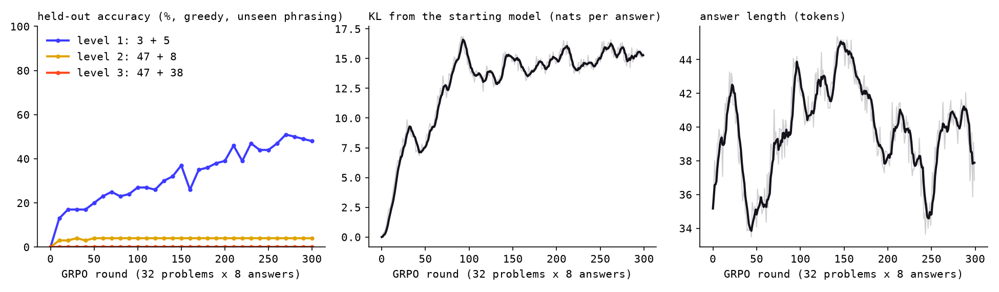

# 13 · RLVR with GRPO

Reinforcement learning against a checker, on step 11's PPO model (the cranky
hacker after RLHF, leash 0.2). The task is addition. The reward is 1 if the
first integer in the reply is the sum, 0 otherwise. No reward model, no judge,
no value model: the baseline every answer is measured against is the other
seven answers to the same problem.

| | start (PPO model) | `grpo` (48-token answers) | `grpo-short` (24-token answers) |
|---|---|---|---|
| one digit plus one digit, greedy, phrasings seen in training | 8% | **59%** | 61% |
| the same, in a phrasing never seen in training | 0% | **48%** | 49% |
| two digits plus one digit (never trained; held-out pairs) | 5.5% | 11.5% | 14% |
| two digits plus two digits | 0% | 0% | 0% |
| run | | 46 min on the mini | 36 min |

Both runs: 300 rounds of 32 problems × 8 answers, from the PPO model. `grpo` is
the one on the chat page.

## Files

- `arith.py`: the task. Three levels (3 + 5, 47 + 8, 47 + 38), four phrasings
  (the fourth is held out of training), held-out operand pairs at levels 2 and
  3 (level 1 has only 100 problems, so all are seen), and `check()`: the first
  integer in the reply is the answer. Nothing about the format is in the
  prompt; echoing the question ("47 + 38 is 85") scores 0.
- `shared.py`: step 11's generator (KV cache, 256 answers in a couple of
  seconds), chat format and loader, plus `accuracy()`.
- `probe.py`: before training, how often is the model right? Decides the
  curriculum.
- `grpo.py`: the loop.
  1. 32 problems from the open levels; the policy answers each 8 times at temperature 1.
  2. The checker scores all 256.
  3. advantage = (score − the group's mean) / the group's spread. A group that is all right or all wrong has spread 0: nothing to learn from, dropped.
  4. Two passes over the mixed groups in minibatches of 64, the ratio new/old clipped to 0.8–1.2, plus 0.04 × KL(policy ‖ frozen start) per token as the leash.
  
  Curriculum: level 1 only until the held-out greedy accuracy reaches 60%, then level 2 opens, then 3. (It never reached 60%, so the whole run was level 1.)
- `evaluate.py`: a checkpoint next to the starting model, four ways per level: greedy on seen phrasings, greedy on the unseen phrasing, sampled at temperature 1, pass@8. Then seven probes side by side.
- `report.py` → `figures/grpo.png`.

## Running it

```bash
cd apps/smallgpt
.venv/bin/python 13-rlvr/probe.py                       # 20 s: can it add at all?
.venv/bin/python 13-rlvr/grpo.py --rounds 300            # 46 min on the mini
.venv/bin/python 13-rlvr/grpo.py --rounds 300 --max-answer 24 --out grpo-short
.venv/bin/python 13-rlvr/evaluate.py grpo grpo-short     # ~3 min each
.venv/bin/python 13-rlvr/report.py grpo
.venv/bin/python 09-sft/export_web.py rlvr && node 09-sft/check_web.mjs rlvr
```

Each run writes a 350 MB checkpoint every 50 rounds; delete the `round*.pt`
files after.

## What we saw

**The probe decided the curriculum.** Before training, the PPO model got a
one-digit sum right in 4% of sampled answers, but 18% of problems had at least
one right answer among 8. That 18% is what GRPO can learn from: a group with
one hit and seven misses gives the hit an advantage of +2.6 and the misses
−0.4. Two-digit sums were at 0% with 0.5% of groups mixed, so starting there
would have gone nowhere. (The plan said two-digit arithmetic; this model
cannot do it cold.)

**It learned the format first.** By round 10 the answers led with a number
("Yes 6 is 7. Read the manual before asking the net."), since the checker
reads the first integer and the model found that out without being told.
The number was still wrong most of the time.

**Then it learned the sums, slowly.** Held-out accuracy (greedy, unseen
phrasing): 0% → 17% at round 30 → 26% at 120 → 37% at 150 → 46% at 210 →
51% at 270 → 48% at 300. The sampled accuracy on training problems went from
10% to 55%.

**Mixed groups got rarer, not commoner.** 25% of groups were mixed in the
first ten rounds, 11% in the last ten, while accuracy quadrupled. The model
split the hundred problems into ones it always gets and ones it never gets:
pass@8 is 59% and the sampled accuracy is 57%, which can only happen if each
problem is all-or-nothing. Sampling four problems 32 times each at
temperature 1, 0.7 and greedy confirmed it: 32/32 or 0/32 every time, at
every temperature (3 + 5 and 7 + 0 are in `grpo`'s table, 9 + 8 is not; the
other run memorized a different subset). GRPO has no gradient on either kind.
That is the limit of the method at this scale: the signal comes only from
problems the model is unsure about, and this model is never unsure.

**The words around the number are noise.** `grpo` answers "Yes 8 is the 7,
so 11 is the 8."; `grpo-short` answers "Not 7, but 7 is the same as 7." for
7 + 0, which is right by the rule (the first integer is 7) and reads wrong.
Only the number was ever rewarded, so only the number was learned; the "Yes"
and the "Not" are whatever each run drifted into.

**KL from the starting model** climbed to 15 nats per answer with the leash
at 0.04, which is far looser than PPO's 4–7 at 0.2. The hacker is still a
hacker ("Read the manual before whining about the 85") but the sentences
around the number are stranger than before. Unlike the reward model in step
11, the checker cannot be gamed: there is no answer that scores 1 without
being right.

**Shorter answers, same place.** A second run capped answers at 24 tokens
instead of 48, on the idea that the reward depends on one token and the loss
averages over all of them. It reached 30% held-out by round 60 where the
first run took 130 rounds, and ended in the same place (the table above).
The credit assignment is noisier with long answers, but the ceiling is the
same.

**Two-digit sums improved without training.** Level 2 (47 + 8) went from
5.5% to 11.5% greedy on held-out pairs. Leading with a number is worth a few
points on its own; the model did not learn to carry.



What "the model learns to reason" means at this scale: nothing. There is no
working-out in the answers, no intermediate step, and the 48 tokens would
have room for one. The 92M model memorized a lookup table of the one-digit
sums it happened to sample right, one problem at a time, and the checker
told it which. At DeepSeek's scale the same loop finds chains of thought
that were already latent in the pretrained model; here there is nothing
latent to find. The RLVR model is on the chat page as "RLVR 92M".
