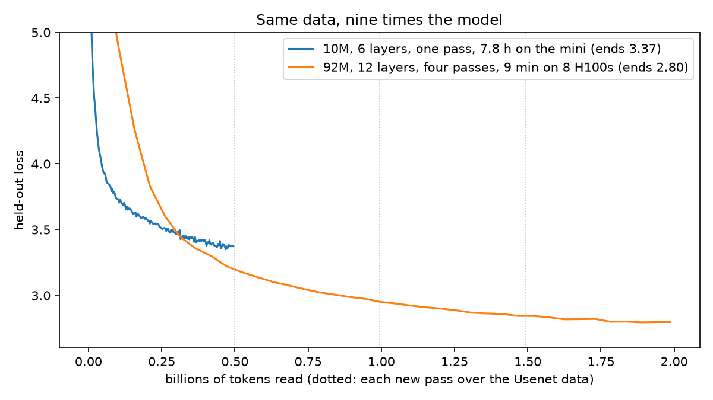

# 13 · Scale up

Step 6b's model at GPT-2 small's shape, trained on the same Usenet data on
eight rented H100s. Moved ahead of steps 11 and 12 (2026-10-16): the 10M
model's answers were near gibberish, and post-training can only choose among
things the model can already do.

| | 6b | 13 |
|---|---|---|
| layers × heads × width | 6 × 8 × 320 | 12 × 12 × 768 |
| window | 256 tokens | 512 tokens |
| parameters | 10.1M | 91.7M |
| data | 497M Usenet tokens, one pass | the same, four passes (1.99B tokens) |
| where | the Mac mini, 7.8 h | 8 × H100 on Together, 9.1 min |
| held-out loss | 3.37 | 2.80 |

The tokenizer is 6b's (8,192), so the embedding table is 8,192 × 768. GPT-2
small is 124M only because its vocabulary is 50k.



## Files

- `model.py` — step 5's GPT, fast: the heads' query/key/value matrices stacked
  into one multiply and PyTorch's fused attention (flash attention on an H100)
  instead of the hand-written scores, mask and softmax. Same weight names, so
  checkpoints load either way; no per-head mask buffers (they would add 150 MB
  to each checkpoint at this size). `load(path, vocab=)` loads any checkpoint
  from steps 6–13, growing the token table for SFT. `09-sft/sft.py`,
  `export_web.py` and `chat.py` load through it.
- `train.py` — step 6's loop plus bfloat16, `torch.compile`, fused AdamW, DDP
  over eight GPUs, ~0.5M-token batches (4 windows of 64 × 512 per GPU before
  each update), 3,791 updates, learning rate 1e-3 warmed up over 200 then
  cosine to a tenth, best.pt kept by held-out loss.
- `pod.yaml` — the Kubernetes pod the run used.
- `compare.py` → `compare.txt` — both sizes on the same openings and questions.
- `report.py` → `figures/loss.png`.

## Running it

Rehearse at home first, so the cluster hour is only the run:

```bash
cd apps/smallgpt
.venv/bin/python 13-scale/train.py --size tiny --steps 30 --no-compile --batch-tokens 16384 --micro 16
.venv/bin/torchrun --nproc_per_node 2 13-scale/train.py --size tiny --steps 30 --no-compile --batch-tokens 16384 --micro 16
```

The cluster (Together Instant Clusters, `tg` CLI from `uv tool install
"together[cli]"`, `TOGETHER_API_KEY` from `.env.local`). Slurm clusters need an
SSH key added on the website or a browser login; a Kubernetes cluster needs
only the API key, so the run goes through `kubectl`:

```bash
tg clusters storage create --region us-central-8 --size-tib 1 --volume-name smallgpt-vol --no-is-lifecycle-independent
tg clusters create --non-interactive --name smallgpt --cluster-type KUBERNETES --gpu-type H100_SXM \
  --region us-central-8 --num-gpus 8 --billing-type ON_DEMAND \
  --nvidia-version-id 0195d44f-e3d0-7475-8197-2a7a7349ab65 --volume <volume id>      # ~17 min to Ready
tg clusters get-credentials <cluster id> --file - --json | python3 -c "import json,sys; print(json.load(sys.stdin)['kubeconfig'])" > kube.yaml
export KUBECONFIG=kube.yaml
kubectl apply -f 13-scale/pod.yaml                                                    # ~3.5 min to pull the image
kubectl exec smallgpt -- pip install -q regex
tar cf - -C 13-scale model.py train.py -C ../02-tokenizer bpe.py -C ../06b-usenet tok8192.json | kubectl exec -i smallgpt -- tar xf - -C /work
tar cf - -C data/usenet train.bin val.bin | kubectl exec -i smallgpt -- bash -c 'mkdir -p /work/data /work/out && tar xf - -C /work/data'
kubectl exec smallgpt -- bash -c 'cd /work && nohup torchrun --standalone --nproc_per_node 8 train.py --data /work/data --tok /work/tok8192.json --out /work/out > /work/out/run.log 2>&1 &'
kubectl exec smallgpt -- tail /work/out/run.log
kubectl exec smallgpt -- tar cf - -C /work/out best.pt log.jsonl run.log | tar xf - -C out/scale
tg clusters delete <cluster id> --non-interactive
tg clusters storage delete <volume id> --force --non-interactive                     # the volume outlives the cluster
```

- `get-credentials` with plain text output wraps long lines and breaks the
  certificate; take it from `--json`.
- The cluster's API hostname failed to resolve now and then on this iMac
  (SERVFAIL); pinning it fixed that: `server: https://<ip>:6443` plus
  `tls-server-name: <hostname>` in the kubeconfig.
- The cluster ran 23:23–23:55 (32 minutes: ~17 to come up, 4 to pull PyTorch,
  half a minute to copy the data in, 9 to train). At ~$4 per GPU-hour that is
  ~$17.

Then SFT, on the mini (the iMac ran out of memory beside the dev server):

```bash
.venv/bin/python 09-sft/sft.py --data 09-sft/qa-usenet.jsonl --out sft-usenet-big --epochs 1 --base out/scale/best.pt
```

One pass, not two: held-out answer loss was lowest after the first (2.96)
and rose in the second, so the bigger model starts memorizing sooner. With
one pass: 3.45 → 2.93 in 96 rounds, 2 minutes (the 10M cranky model ended at
3.45, which is where the 92M one starts before any SFT).

## What we saw

Throughput 4.36M tokens a second across the eight GPUs; the whole run 9.1
minutes, against 7.8 hours for one pass of the 10M model on the mini. Held-out
loss 9.13 → 3.2 after one pass (already below the 10M model's 3.37) → 2.95
after two → 2.80 after four; train 2.70, so the repeats cost a little but held-
out loss was still falling at the end. (The window is 512 instead of 256,
which also helps the loss a bit.)

The base model writes believable posts, holding a thought across sentences:

> Newsgroups: comp.sys.mac / Subject: Mac Plus won't boot
> I was trying to install a Mac Plus together with a IIx. I got the following
> message: "Press reset. Folder reset. Disk is not installed" ...etc. I tried
> the same initation but the same result. What am I doing wrong? Any help
> would be appreciated.

The 10M one on the same opening: "I have a Mac Plus with a Mac SE with 2 meg
of RAM. I would like to have a Mac Plus with 2 meg memory. If so, how about
that, and how about my Mac Plus?"

The cranky hacker loops less and stays on the question, but the facts are
still made up: "Is the Korn shell available for Xenix on the 386?" → "No,
it's not yet. It's in the public domain, and you won't see it until
mid-November. Don't expect much more from it." (10M: "Don't expect it. The
386 manual is the best, but it's on the 286; it's not the original author's
name…"). Greedy decoding still loops ("It's a SIMM, not a SIMM. The SIMM is a
SIMM…"), which is what step 11's preferences should push against.

## On the chat page

`09-sft/export_web.py` exports the 92M models (`cranky`, `base`) at 92.4 MB
int8 each. That is too big for the repo, so the .bin is cut into 24 MB parts
named by a hash of the content and uploaded to the public Supabase Storage
bucket `smallgpt`; the .json in `public/smallgpt/chat/` lists the URLs and the
worker fetches the parts in parallel with a progress line. The 10M models stay
in the repo as `cranky-10m`, `helpful`, `base-10m`. The page downloads the
default model when the visitor first focuses the question box, not on load.
In the browser the 92M model takes ~75 ms a token (the 10M one 9), and
`09-sft/check_web.mjs` confirms the JavaScript gives PyTorch's int8 answers
token for token.
